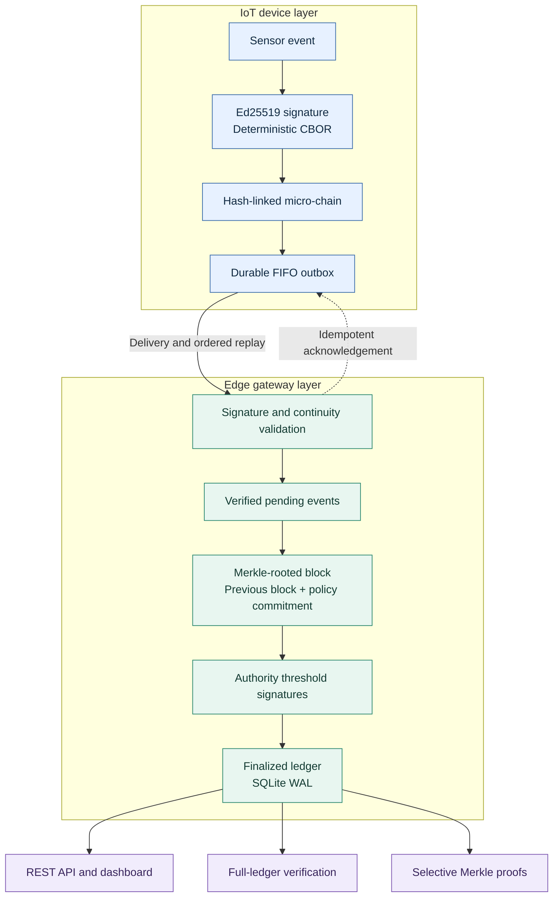

<div align="center">

# EdgeChainDB

**Continuity-aware, quorum-signed edge ledger for resilient IoT telemetry**

Tamper-evident telemetry · Verifiable device continuity · Durable offline operation

[](https://github.com/vtavakkoli/EdgeChainDB/actions/workflows/ci.yml)
[](pyproject.toml)
[](pyproject.toml)
[](LICENSE)
[](docker-compose.yml)

[](https://doi.org/10.1109/CloudCom71355.2026.00074)
[](https://doi.org/10.1109/CloudCom71355.2026.00074)
[](#security-model-and-limitations)
[](#architecture)

[Research paper](#research-publication) · [Quick start](#quick-start) · [Architecture](#architecture) · [Experiments](#reproduce-the-research) · [Documentation](#documentation)

</div>

## Overview

EdgeChainDB is an open-source, edge-first telemetry database that combines the queryability of SQLite with cryptographic evidence of data origin, sequence continuity, block membership, and threshold approval. It is designed for IoT environments in which devices may lose connectivity and telemetry must remain auditable after reconnection.

Instead of running proof-of-work or per-event consensus on constrained devices, EdgeChainDB signs events at their source and delegates validation, Merkle batching, storage, and authority approval to edge infrastructure.

**Applications:** industrial IoT, smart buildings, energy systems, fleet monitoring, municipal IoT, and security research.

## Research publication

> **EdgeChainDB: A Continuity-Aware Quorum-Signed Edge Ledger for Resilient IoT Telemetry**  
> Kabeh Mohsenzadegan, Vahid Tavakkoli, and Kyandoghere Kyamakya  
> University of Klagenfurt, Austria  
> *2026 IEEE 17th International Conference on Cloud Computing Technology and Science (CloudCom)*, Paris, France, pp. 516–523.

**[Read the published IEEE paper](https://doi.org/10.1109/CloudCom71355.2026.00074)** · [Citation and BibTeX](PAPER.md)

### Published evaluation at a glance

<div align="center">

| Canonical experiment runs | Events delivered and finalized | Ledger verification | SQLite integrity checks |
| :---: | :---: | :---: | :---: |
| **180 / 180** | **499,950** | **All passed** | **All passed** |

</div>

These figures are the reported results of the published evaluation, as documented in [PAPER.md](PAPER.md). They describe the evaluated workload, not a general availability or security guarantee. Generate independent results using the [reproduction workflow](#reproduce-the-research).

## Core capabilities

| Capability | Implementation |
| --- | --- |
| **Device-origin authentication** | Ed25519 signatures over deterministic CBOR |
| **Continuity-aware ingestion** | Per-device sequence numbers and previous-event hashes |
| **Tamper-evident batching** | SHA-256 Merkle roots and hash-linked gateway blocks |
| **Threshold finality** | Configurable authority quorum and signed block headers |
| **Queryable persistence** | SQLite WAL and transactional storage |
| **Selective verification** | Merkle membership proofs for finalized events |
| **Intermittent connectivity** | Durable device outbox and ordered, idempotent replay |
| **Policy commitment** | Block-level commitment to validation and batching policy |
| **Observability** | Live dashboard, telemetry, container health, and logs |
| **Reproducibility** | Automated Docker experiments and JSON, CSV, and HTML reports |

## Architecture



Each device maintains its own signed micro-chain. The gateway verifies event authenticity and continuity before accepting it, groups accepted events into Merkle-rooted macro-chain blocks, and finalizes blocks once the configured authority threshold is met.

The ledger verifier rechecks signatures, device-chain continuity, block links, Merkle roots, policy commitments, authority snapshots, and quorum signatures. SQLite provides local transactional persistence; the cryptographic layer supplies additional integrity evidence.

## Quick start

### Option A — Docker Compose (recommended)

**Prerequisites:** Git, Docker Engine or Docker Desktop, and Docker Compose v2.

```bash
git clone https://github.com/vtavakkoli/EdgeChainDB.git
cd EdgeChainDB
docker compose up -d --build run
```

This launches the persistent gateway and 20 independently controlled IoT device containers.

| Interface | URL |
| --- | --- |
| Live operations dashboard | [http://127.0.0.1:3030](http://127.0.0.1:3030) |
| Interactive API documentation | [http://127.0.0.1:8000/docs](http://127.0.0.1:8000/docs) |
| Gateway health | [http://127.0.0.1:8000/health](http://127.0.0.1:8000/health) |
| Database information | [http://127.0.0.1:3030/database/info](http://127.0.0.1:3030/database/info) |

```bash
docker compose ps
docker compose logs -f gateway
```

Stop the cluster while preserving data:

```bash
docker compose down
```

> [!WARNING]
> The dashboard uses the local Docker socket for development cluster control. Keep it on localhost. Do not expose it publicly or use `down -v` unless you intend to delete the persistent ledger and device identities.

### Option B — Native Python

Python 3.12 is the reference runtime; CI also covers Python 3.11 and 3.13.

```bash
git clone https://github.com/vtavakkoli/EdgeChainDB.git
cd EdgeChainDB
python -m venv .venv
source .venv/bin/activate
python -m pip install -e ".[dev]"
```

On Windows PowerShell, activate the virtual environment with:

```powershell
.\.venv\Scripts\Activate.ps1
```

Run a self-contained demonstration:

```bash
edgechain-demo --database demo.db --events 12
```

The demo enrolls devices and authorities, generates signed events, finalizes blocks, audits the ledger, and verifies a Merkle inclusion proof.

Start a standalone gateway:

```bash
python -m edgechaindb.gateway_server \
  --database edgechain.db \
  --node-key edgechain-node.key \
  --host 127.0.0.1 \
  --api-port 8000 \
  --monitor-port 3030
```

The standalone gateway defaults to a development quorum of one. Use separate authority keys and an appropriate threshold for multi-authority experiments.

## Python API

The following example creates a local ledger, enrolls an authority and a device, signs a temperature event, and checks the ledger.

```python
from edgechaindb.crypto import KeyPair
from edgechaindb.device import DeviceClient
from edgechaindb.ledger import EdgeChainLedger
from edgechaindb.store import Database

db = Database("factory.db")
ledger = EdgeChainLedger(db, quorum_threshold=1)

authority = KeyPair.generate()
ledger.register_authority("factory-gateway-a", authority.public_bytes)

device_key = KeyPair.generate()
ledger.register_device("temperature-01", device_key.public_bytes)
device = DeviceClient("temperature-01", device_key)

event = device.create_event(
    event_type="temperature",
    payload={"temperature_milli_celsius": 23650},
)
ledger.accept_event(event)

block = ledger.propose_block("factory-gateway-a", authority.private_key)
print(block["status"])
print(ledger.verify_all())
```

Use a fresh database for this example because newly generated keys will not match existing identities. See the [operations guide](docs/OPERATIONS.md) for REST event formats and MQTT integration guidance.

## Live dashboard

The local operations dashboard provides:

- Individual start, stop, pause, resume, and restart controls for all 20 device containers.
- Live temperature, humidity, battery, sequence, finality, and clock-lag observations.
- Container health, CPU and memory usage, traffic, IP addresses, and logs.
- Ledger state, database and WAL size, integrity information, and benchmark progress.

The dashboard is intended for local research and development, not production orchestration.

## Reproduce the research

EdgeChainDB includes three complementary evaluation workflows: a 20-node system benchmark, a standalone validation suite, and a configurable Docker experiment campaign.

### 1. System and security benchmark

Start the running cluster first, then execute the complete benchmark:

```bash
docker compose up -d --build run
docker compose up -d --build test
docker compose logs -f test
```

The test coordinator checks ingestion, forged signatures, replay-safe retries, out-of-order delivery, broken chain links, checkpoint recovery, block sealing, quorum finality, membership proofs, complete ledger audit, and restart recovery.

Eight research benchmark groups cover:

| Measurement | Evaluation focus |
| --- | --- |
| Signing energy | RAPL where available; explicitly labelled estimates otherwise |
| Bytes per event | Encoding, signatures, wire format, storage |
| Ingest throughput | Concurrent load; p50, p95 and p99 latency |
| Finality latency | Event-to-quorum-finality delay |
| Storage overhead | SQLite, indexes, blocks and signatures |
| Integrity detection | Replay and destructive deletion |
| Offline recovery | Outbox, reconnection and idempotent retry |
| Quorum resilience | Invalid signatures and threshold-specific liveness |

### 2. Independent validation suite

Quick local validation:

```bash
edgechain-validation --profile smoke --result-dir result/validation
```

Complete validation with Docker:

```bash
docker compose --profile validation run --rm validation \
  --profile full --result-dir /app/result/validation
```

The full profile evaluates 14 ledger mutation classes, untouched control ledgers, matched unsigned SQLite WAL baselines, and offline buffer saturation and recovery boundaries.

### 3. Balanced research campaign

Run the default resumable campaign:

```bash
docker compose up --build -d experiment
docker compose logs -f experiment
```

The [default balanced design](experiments/one-day.yaml) uses 60 configurations per repetition and three repetitions, for 180 runs and 499,950 nominal events. It uses fixed-seed screening rather than an exhaustive factorial cross.

| Factor | Configured levels |
| --- | --- |
| Devices | 1, 5, 20, 50, 100 |
| Total events | 10, 100, 1,000, 10,000 |
| Block size | 1, 16, 64, 256, 1,024 |
| Authorities / threshold | 1/1, 3/2, 4/3, 7/5 |
| Packet loss | 0%, 1%, 5%, 10% |
| Gateway outage | 5 s, 30 s, 300 s |

The campaign is resumable. Its duration depends on hardware, container overhead, workload, and outage settings. Do not run multiple coordinators against the same results directory.

Other configurations: [smoke](experiments/smoke.yaml), [five repetitions](experiments/one-day-5-repetitions.yaml), [full factorial](experiments/full-matrix.yaml), and [large-scale stress matrix](experiments/large-scale-matrix.yaml).

### Result artifacts

Generated evidence is written locally to `result/`; the repository does not bundle the full raw results.

| Artifact | Location |
| --- | --- |
| System benchmark | `result/report.html`, `result/result.json` |
| Research microbenchmarks | `result/benchmarks/report.html` |
| Independent validation | `result/validation/report.html` |
| Experiment campaign | `result/experiments/report.html` |
| Machine-readable campaign results | `result/experiments/summary.json`, `result/experiments/results.csv` |
| Progress and run evidence | `result/experiments/progress.json` and per-run artifacts |

Detailed commands, timeout behavior, recovery instructions, and sharding workflows are in the [operations guide](docs/OPERATIONS.md).

## Technology stack

| Layer | Technology |
| --- | --- |
| Runtime | Python 3.11+; Python 3.12 reference |
| API | FastAPI, Uvicorn, Pydantic |
| Persistence | SQLite WAL |
| Cryptography | Ed25519, SHA-256, Merkle trees |
| Canonical encoding | Deterministic CBOR |
| Test and experiment tooling | pytest, httpx, PyYAML |
| Container infrastructure | Docker, Docker Compose |
| Continuous integration | GitHub Actions |

## Repository structure

```text
EdgeChainDB/
├── edgechaindb/        # Ledger, cryptography, storage, API and runtime
│   └── experiments/   # Campaign planning, execution and reporting
├── experiments/        # Reproducible experimental configurations
├── tests/              # Unit, integration and regression tests
├── scripts/            # Bash and PowerShell automation
├── docs/               # Detailed operational documentation
├── result/             # Generated evidence and reports (local)
├── .github/workflows/  # Continuous integration
├── docker-compose.yml  # Distributed development testbed
├── pyproject.toml      # Package metadata and dependencies
├── CITATION.cff        # Preferred academic citation
└── PAPER.md            # IEEE publication details
```

## Quality assurance

The [CI workflow](.github/workflows/ci.yml) runs the test suite across Python 3.11, 3.12, and 3.13, compiles Python sources, executes a smoke validation on Python 3.12, validates the Compose configuration, and tests the built Docker image.

Run the checks locally after installing development dependencies:

```bash
python -m compileall -q edgechaindb tests
python -m pytest
docker compose config --quiet
```

The live CI badge at the top reflects the workflow status rather than claiming a fixed passing result.

## Security model and limitations

EdgeChainDB is a **research-quality prototype**, not a production security product or a fully replicated asynchronous Byzantine-fault-tolerant database.

Its integrity guarantees depend on authentic enrollment, protected signing keys, trustworthy authority configuration, and the availability of appropriate verification evidence. Valid signatures authenticate the source of telemetry, not the physical accuracy of its measurements. Threshold approval is not equivalent to distributed consensus, and a locally consistent ledger does not independently establish completeness against wholesale rollback or replacement without a trusted external checkpoint.

Production adoption would require authenticated enrollment, TLS/mTLS, hardware-backed keys, key rotation and revocation, external anchoring, networked quorum coordination, replicated failover, backup and recovery procedures, authorization, rate limiting, and independent security review.

Report vulnerabilities privately according to [SECURITY.md](SECURITY.md).

## Documentation

| Resource | Purpose |
| --- | --- |
| [Operations and benchmark guide](docs/OPERATIONS.md) | Full CLI, API, Docker, scaling and troubleshooting reference |
| [Research paper and citation](PAPER.md) | Publication details and BibTeX |
| [Experiment configurations](experiments/) | Executable evaluation designs |
| [Security policy](SECURITY.md) | Security scope and responsible disclosure |
| [Contribution guide](CONTRIBUTING.md) | Development and review workflow |
| [Changelog](CHANGELOG.md) | Version history |
| [Issue tracker](https://github.com/vtavakkoli/EdgeChainDB/issues) | Bug reports and feature requests |

## Citation

If EdgeChainDB contributes to your research, please cite the published IEEE paper:

```bibtex
@inproceedings{mohsenzadegan2026edgechaindb,
  author    = {Mohsenzadegan, Kabeh and Tavakkoli, Vahid
               and Kyamakya, Kyandoghere},
  title     = {EdgeChainDB: A Continuity-Aware Quorum-Signed
               Edge Ledger for Resilient IoT Telemetry},
  booktitle = {2026 IEEE 17th International Conference on
               Cloud Computing Technology and Science (CloudCom)},
  year      = {2026},
  pages     = {516--523},
  address   = {Paris, France},
  publisher = {IEEE},
  doi       = {10.1109/CloudCom71355.2026.00074}
}
```

The repository also provides machine-readable [CITATION.cff](CITATION.cff) metadata for citation managers and GitHub's citation interface.

## Contributing and license

Contributions to integrity verification, device resilience, experimental methodology, documentation, and testing are welcome. Please review the [contribution guidelines](CONTRIBUTING.md) before opening a pull request.

EdgeChainDB is distributed under the [MIT License](LICENSE).

---

<div align="center">

**EdgeChainDB** · Open-source research for auditable and resilient edge telemetry

[IEEE publication](https://doi.org/10.1109/CloudCom71355.2026.00074) · [Source code](https://github.com/vtavakkoli/EdgeChainDB) · [Issues](https://github.com/vtavakkoli/EdgeChainDB/issues)

</div>
